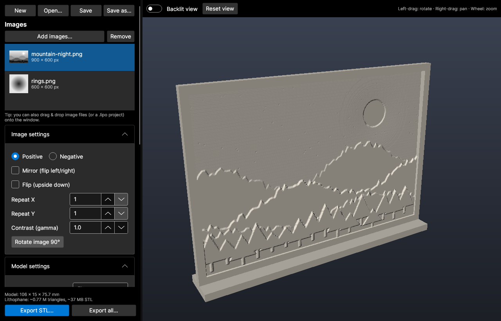
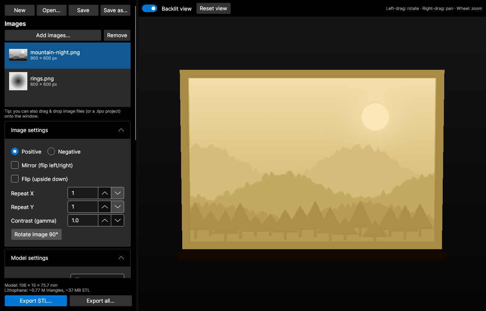
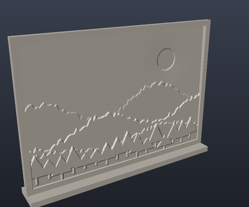
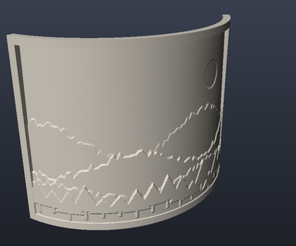
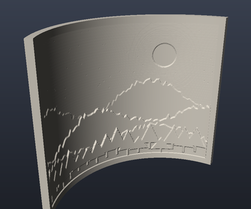
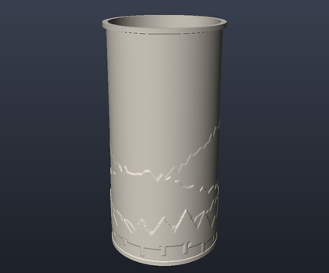
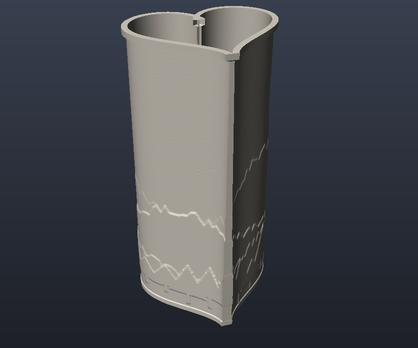
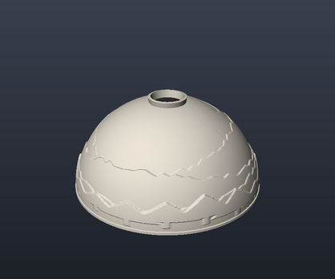
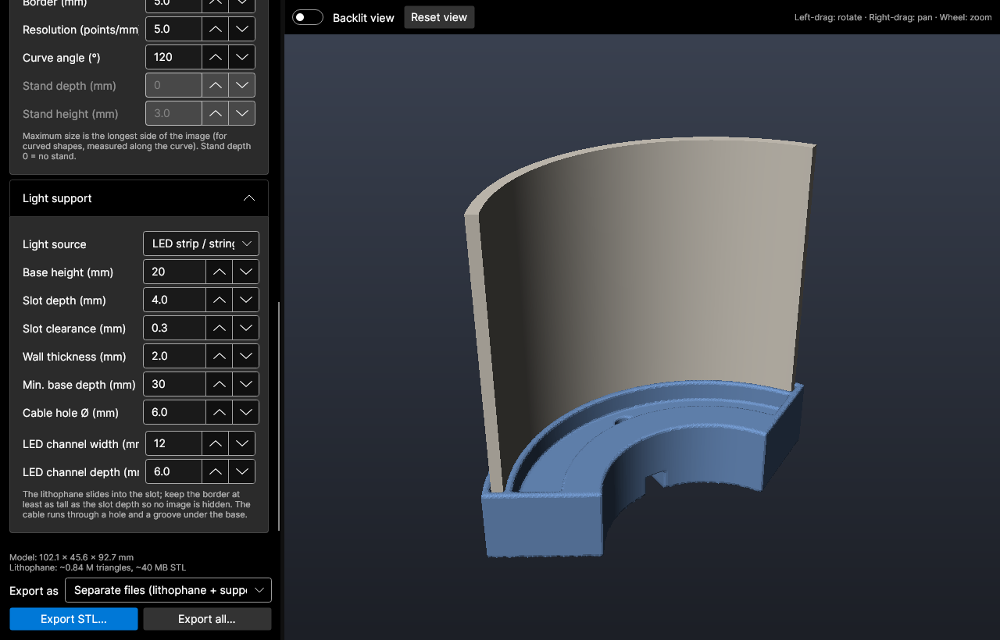
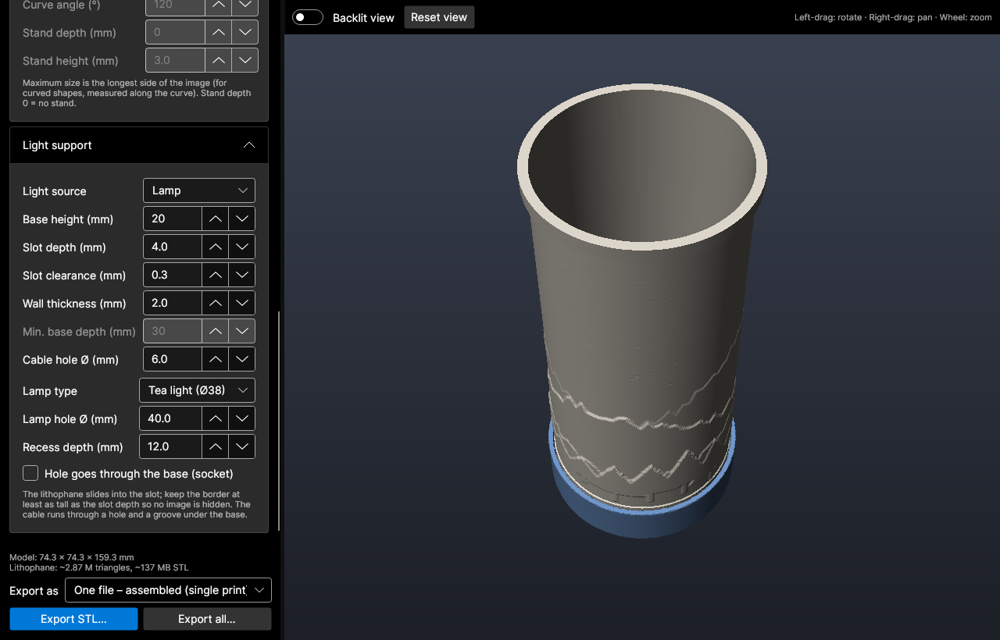

# Lithophane Maker

A cross-platform desktop app that turns photos into **3D-printable lithophanes**. It exports watertight
STL files for flat panels, curved panels, cylinder lamps, hearts and domes. It can also generate a matching **light support**
base for an LED strip, a tea light or a lamp socket.

Built with C# / .NET 10 and [Avalonia UI](https://avaloniaui.net/). It runs on **Linux and Windows**, needs no
internet connection, and was inspired by [3dp.rocks/lithophane](https://3dp.rocks/lithophane/).



---

## Contents

- [Features](#features)
- [Screenshots](#screenshots)
- [Getting started](#getting-started)
- [Quick start](#quick-start)
- [Documentation](#documentation)
- [Project structure](#project-structure)

## Features

- **Many images at once**: add PNG, JPG, BMP, GIF, WEBP… with the button or by drag & drop. EXIF
  rotation is respected.
- **Image controls**: positive / negative, mirror, flip, repeat (tile) in X and Y, contrast (gamma), and
  90° rotation.
- **Six shapes**: flat, outer curve, inner curve, cylinder (lamp), heart and dome.
- **Model controls**: maximum size, maximum and minimum thickness, border, mesh resolution, curve angle,
  and an optional stand.
- **Light support base**, generated to fit the lithophane:
  - a slot the lithophane slides into, with adjustable depth and clearance
  - an **LED strip / string** channel behind flat and curved panels, or a tray inside cylinders,
    hearts and domes
  - a **lamp** recess or through-hole, with presets for tea lights, LED pucks, E14 / E27 sockets and M10
    lamp tubes (or any custom size)
  - a cable hole plus a groove under the base, so the base still sits flat with the cable in place
- **Three export layouts**: separate files, one file with the parts side by side, or one file with the
  lithophane standing in its support (printed as a single piece).
- **Interactive 3D preview** (rotate, pan, zoom) with a **backlit mode** that simulates light shining
  through the print.
- **Watertight binary STL** export for the selected image, or for every image into a folder.
- **Projects (`.lipo`)** store all settings and **embed the images**, so a project still opens after the
  original files are moved.
- **Session restore**: the app reopens where you left off, including unsaved changes.

## Screenshots

### Backlit preview

Turn on **Backlit view** to see roughly how the print will look with a light behind it. Thin areas
glow and thick areas stay dark.



### Shapes

| Flat (with stand) | Outer curve | Inner curve |
|:---:|:---:|:---:|
|  |  |  |
| **Cylinder (lamp)** | **Heart** | **Dome** |
|  |  |  |

### Light supports

| LED strip channel behind a curved panel | Tea-light base under a cylinder lamp |
|:---:|:---:|
|  |  |

The support is drawn in blue in the preview. See the [user guide](docs/USER_GUIDE.md#light-support) for
every option.

## Getting started

### Requirements

- [.NET 10 SDK](https://dotnet.microsoft.com/download) (only needed to build; a self-contained build runs
  without it)
- Linux (X11 or Wayland via XWayland) or Windows 10/11

### Run from source

```bash
git clone <this-repository-url>
cd LithophaneGUI
dotnet run -c Release
```

### Build a standalone executable

```bash
# Linux
dotnet publish -c Release -r linux-x64 --self-contained -o publish/linux

# Windows
dotnet publish -c Release -r win-x64 --self-contained -o publish/windows
```

Run `publish/linux/LithophaneGUI` or `publish\windows\LithophaneGUI.exe`.

### Command line

```bash
LithophaneGUI photo1.jpg photo2.png   # start with these images
LithophaneGUI my-lamp.lipo            # open a project
```

## Quick start

1. Click **Add images…** or drag photos onto the window.
2. Pick a **Shape** under *Model settings* and set the **Maximum size** (the longest side of the image,
   in mm).
3. Check the result in the 3D preview. Turn on **Backlit view** to judge the contrast.
4. Optional: choose a **Light source** under *Light support* to generate a base.
5. Click **Export STL…** and slice the file. Print it upright at 100% infill in white or natural PLA.
6. Press **Ctrl+S** to save the project as a `.lipo` file so you can come back to it later.

The [user guide](docs/USER_GUIDE.md) explains every setting and includes printing tips.

## Documentation

| Document | What's inside |
|---|---|
| [User guide](docs/USER_GUIDE.md) | Every setting, projects, export layouts, printing tips, troubleshooting |
| [How it works](docs/ARCHITECTURE.md) | Generation pipeline, mesh construction, light support modelling, preview renderer |

## Project structure

| Path | Purpose |
|---|---|
| `Core/GrayImage.cs` | Image loading → luminance |
| `Core/HeightMap.cs` | Luminance → thickness grid (border, repeat, mirror…) |
| `Core/Surfaces.cs` | Shape definitions (arc-length parameterised profiles, dome) |
| `Core/LithophaneGenerator.cs` | Builds the closed solid mesh (front, back, walls, stand) |
| `Core/LightSupportGenerator.cs` | Light support base, modelled as a signed distance field |
| `Core/SurfaceNets.cs` | Distance field → watertight mesh |
| `Core/StlWriter.cs` | Binary STL output |
| `Core/LithophaneProject.cs` | `.lipo` project file (JSON: settings + embedded images) |
| `Rendering/SoftwareRenderer.cs` | Multi-threaded z-buffer preview renderer |
| `Controls/PreviewControl.cs` | Interactive preview control |
| `MainWindow.axaml(.cs)` | UI |

The model stands upright (Z = up), which is the usual orientation for printing lithophanes.
