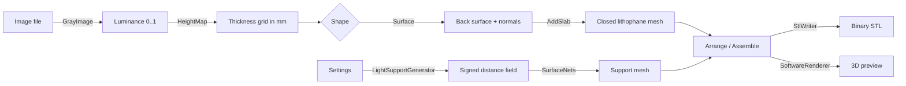

# How it works

This document explains how an image becomes a printable STL file. It is aimed at contributors and anyone
curious about the geometry.

## Overview



All geometry code lives in `Core/` and has no UI dependencies. The only external dependency is SkiaSharp,
which is used for image decoding.

## 1. Image → luminance (`GrayImage`)

The image is decoded with SkiaSharp into RGBA and converted to a single luminance channel in `[0, 1]`
(1 = white). Transparent pixels are blended onto white, and EXIF orientation is applied. `Sample(x, y)`
does bilinear interpolation so the mesh resolution does not depend on the image resolution.

## 2. Luminance → thickness (`HeightMap`)

The model is first built in a flat, *unrolled* space: `x` runs along the width (the arc length for curved
shapes) and `z` runs up. The grid size follows from **Maximum size** × **Resolution**. For the preview, the
resolution is scaled down so the grid stays under a node budget of 150 000 nodes.

For every node:

1. Nodes in the **border** get the full `Thickness`. Closed shapes have no side border, because the image
   wraps around.
2. Otherwise the image coordinate is computed, with mirror, flip and repeat (tiling) applied.
3. The luminance is sampled and raised to the **gamma** power.
4. `darkness = 1 − luminance` (or `luminance` in negative mode).
5. `thickness = MinThickness + darkness × (Thickness − MinThickness)`.

## 3. Shapes (`Surfaces`)

A `Surface` maps an unrolled point `(x, z)` to a 3D position on the model's back surface, plus the
direction in which the relief grows.

- **Flat, outer curve, inner curve, cylinder, heart** are `ProfileSurface`s: a 2D curve extruded
  vertically. Each curve is **reparameterised by arc length** and scaled so its length equals the unrolled
  width. The image is therefore never stretched, even on the uneven heart curve. Normals come from the
  curve's tangent.
- **Dome** is a `DomeSurface`: a spherical cap that is open at the top. The image width wraps around the
  rim and the image height climbs towards the pole.

## 4. Building the solid (`LithophaneGenerator.AddSlab`)

For every grid node the generator creates two vertices:

- a **back** vertex on the surface
- a **front** vertex offset along the normal by the node's thickness

Front and back faces are triangulated as quads. Side walls close the boundary; for closed shapes the grid
wraps in `u`, so only the top and bottom edges need walls. The result is a **closed, manifold solid**, and
the winding is flipped if the signed volume comes out negative. An optional stand is added as a second slab
under the bottom edge.

## 5. Light support (`LightSupportGenerator` + `SurfaceNets`)

The support has slots, channels, recesses, holes and grooves that follow arbitrary curves. Building that
directly from triangles would be fragile, so it is modelled as a **signed distance field (SDF)** instead:

- `ProfileField` gives, for any XY point, the signed offset from the footprint curve and the arc-length
  position of the nearest point. Open curves are extended straight past their ends.
- The base is built from CSG-style `min`/`max` combinations of simple distances: the outer body, minus the
  slot (thickness + clearance), minus the LED channel/tray or lamp recess/hole, minus the cable hole and
  the groove underneath.
- For closed shapes, the lamp is centred on the approximate **largest inscribed circle** of the
  footprint. The lamp diameter is reduced if it would not fit.
- The field is sampled on a regular voxel grid. The spacing is chosen so the grid stays within a cell
  budget: 500 000 cells for the preview and 4 000 000 for export.

`SurfaceNets` turns the field into a mesh (naive surface nets: one vertex per cell the surface crosses,
one quad per crossed grid edge). The outermost layer of samples is forced to "outside", which guarantees a
watertight result.

When settings conflict (for example, a base too low for the cable groove), the generator adjusts the
geometry and returns human-readable notes, which the UI shows with a ⚠.

## 6. Layout and export (`Arrange`, `StlWriter`)

`GenerateParts` returns the lithophane and the support in a shared coordinate frame, with the lithophane
standing in the slot. `Arrange` then produces the files for the chosen layout:

- **Separate files**: each part placed on the bed on its own (`_lithophane`, `_light_support` suffixes).
- **Side by side**: the support moved behind the lithophane with a 5 mm gap, in one mesh.
- **Assembled**: the parts as they fit together, in one mesh.

`PlaceOnBed` centres every mesh in X/Y and puts it on Z = 0. `StlWriter` writes **binary STL**: an 80-byte
header, a triangle count, and 50 bytes per triangle.

## 7. Preview (`SoftwareRenderer`, `PreviewControl`)

The preview does not use the GPU. It is a small **multi-threaded z-buffer rasteriser** that writes into a
`WriteableBitmap`, so it works the same on every platform and inside VMs.

- **Normal mode:** flat shading with a headlight slightly above and to the left of the camera. The support
  is drawn in blue as a secondary part of the mesh.
- **Backlit mode:** every lithophane vertex carries its thickness. Transmission is modelled as
  `exp(−k · (t − tMin))`, with `k` chosen so the thickest areas pass about 1/25 of the light, and mapped to
  a warm lamp-like colour ramp.

`OrbitCamera` handles yaw, pitch, distance and pan, and frames the mesh from the front when a new model is
loaded. Preview generation runs on a background task, is debounced by 250 ms, and is cancelled when
settings change again.

## 8. Projects (`LithophaneProject`)

A `.lipo` file is indented JSON containing:

```jsonc
{
  "Version": 1,
  "Settings": { "Shape": "Cylinder", "MaxSize": 200, "Thickness": 3, ... },
  "Layout": "SeparateFiles",
  "LampPreset": 0,
  "Backlit": false,
  "SelectedImage": 0,
  "Images": [
    { "SourcePath": "/home/me/photo.jpg", "Data": "<base64 of the original file>", "Rotation": 1 }
  ]
}
```

Enums are stored as strings, so the files are readable and robust to reordering. Saving writes to a
temporary file first and then renames it, so a failed save never corrupts an existing project. Files with
a newer `Version` are rejected with a clear message.

Session restore uses the same format: on close, unsaved work is written to `session.lipo` in the user
configuration folder, together with a small `state.json` that records the last project path and whether
it had unsaved changes.
