# User guide

This guide walks through the whole window, from top to bottom, and ends with printing tips and
troubleshooting.

- [What is a lithophane?](#what-is-a-lithophane)
- [The main window](#the-main-window)
- [Projects](#projects)
- [Images](#images)
- [Image settings](#image-settings)
- [Model settings](#model-settings)
- [Light support](#light-support)
- [3D preview](#3d-preview)
- [Exporting](#exporting)
- [Printing tips](#printing-tips)
- [Troubleshooting](#troubleshooting)
- [Keyboard shortcuts](#keyboard-shortcuts)

---

## What is a lithophane?

A lithophane is a thin plate whose thickness varies with the brightness of an image. When a light shines
through it from behind, thin areas let more light pass and look bright, and thick areas look dark, so the
picture appears. Printed in white or natural PLA, a lithophane looks like a plain relief in daylight and
shows the full photo when it is lit.

| Source image | Unlit print (relief) | Backlit |
|:---:|:---:|:---:|
| 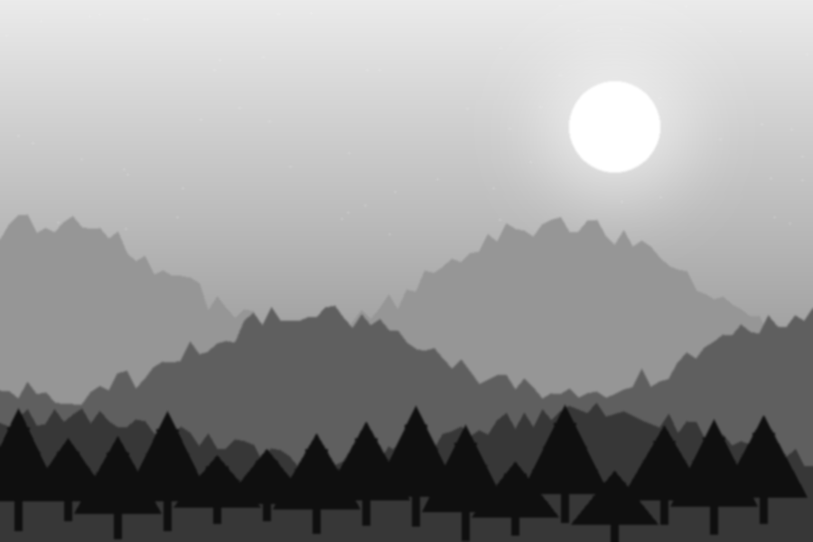 | 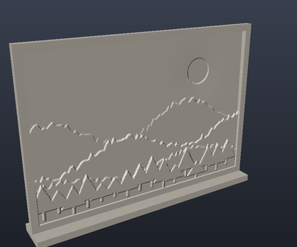 | 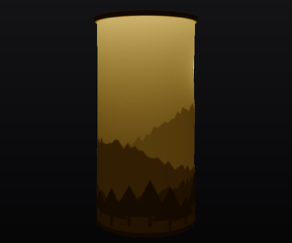 |

## The main window

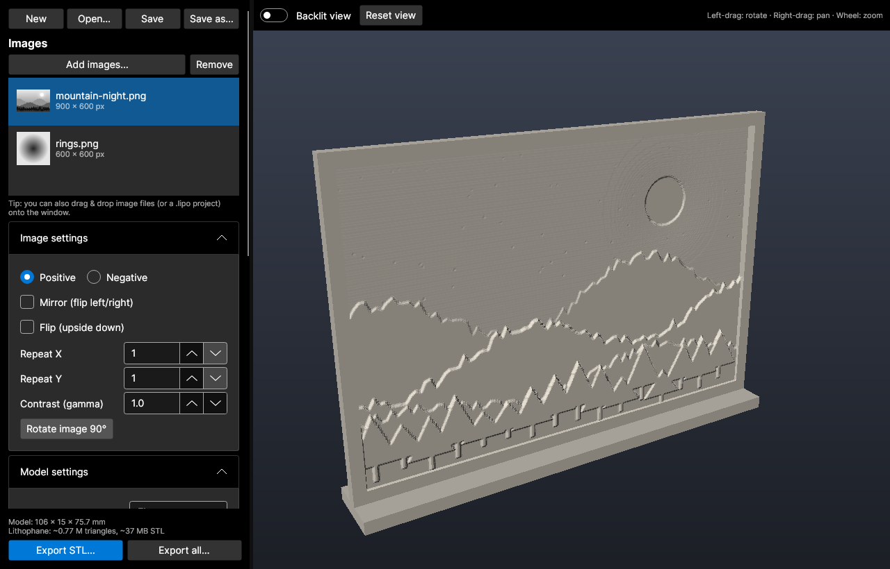

The **left panel** holds every setting, grouped into collapsible sections. The bottom of the panel shows
the model size, an estimate of the triangle count and STL file size, and the export buttons. The **right
side** is the interactive 3D preview.

**Hover over any setting** (its label or its input box) and a tooltip appears with a small sketch of
what the parameter means and a short explanation, so you rarely need this guide while working.

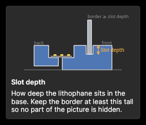

The preview updates automatically about a quarter of a second after you stop changing a value. To stay
responsive it uses a reduced mesh resolution; **exports always use the full resolution** you set.

## Projects

The four buttons at the top manage `.lipo` project files:

| Button | Shortcut | Action |
|---|---|---|
| **New** | Ctrl+N | Clears all images and resets the settings |
| **Open…** | Ctrl+O | Opens a `.lipo` project |
| **Save** | Ctrl+S | Saves to the current project file (asks for a name the first time) |
| **Save as…** | Ctrl+Shift+S | Saves under a new name |

A project stores:

- all image, model and light-support settings
- the export layout, the lamp preset and the backlit toggle
- **a copy of every image file** (with its rotation), so a project stays complete when the originals are
  moved, renamed or deleted

The window title shows the project name, with a `*` when there are unsaved changes. If you start a new
project or open another one while there are unsaved changes, you are asked whether to save first.

You can also open a project by **dropping a `.lipo` file onto the window**, or by passing it on the command
line (`LithophaneGUI my-project.lipo`).

**Session restore:** when you close the app, your work is remembered. The next start reopens the last
project, including changes you had not saved yet. The session is stored in the user configuration folder
(`~/.config/LithophaneGUI` on Linux, `%APPDATA%\LithophaneGUI` on Windows).

## Images

- **Add images…** opens a file picker (multiple selection allowed). You can also **drag & drop** image
  files onto the window.
- Supported formats include PNG, JPG/JPEG, BMP, GIF, WEBP and ICO. HEIC/HEIF/AVIF work where the platform's
  image decoder supports them.
- Colour images are converted to brightness (luminance). Transparent pixels are treated as white.
- **Remove** deletes the selected image from the list (not from disk).
- Selecting an image in the list shows it in the preview. All images share the same settings, so
  **Export all…** produces a matching set.

## Image settings

| Setting | Effect |
|---|---|
| **Positive / Negative** | *Positive* (the usual choice) makes dark image areas thick, so the lit print looks like the photo. *Negative* inverts this. |
| **Mirror** | Flips the image left ↔ right. |
| **Flip** | Turns the image upside down. |
| **Repeat X / Y** | Tiles the image 1–20 times across and/or up. Useful for patterns on lamps. |
| **Contrast (gamma)** | Applied to brightness before it becomes thickness. Values **above 1** darken the mid-tones (more material and more contrast in the highlights). Values **below 1** brighten them. 1.0 leaves the image unchanged. |
| **Rotate image 90°** | Rotates the selected image clockwise. The rotation is saved in the project. |

> **Tip:** photos with good contrast and a clear subject work best. Very dark photos turn into thick,
> mostly opaque prints. Try a gamma below 1, or brighten the photo first.

## Model settings

| Setting | Default | Meaning |
|---|---|---|
| **Shape** | Flat | See [Shapes](#shapes) below. |
| **Maximum size (mm)** | 100 | Length of the image's **longest side**. For curved and closed shapes it is measured **along the curve** (for a cylinder, the image width is the circumference). |
| **Thickness (mm)** | 3.0 | Thickness of the **darkest** areas and of the border. |
| **Thinnest layer (mm)** | 0.8 | Thickness of the **brightest** areas. Lower values give more contrast but a more fragile print. Don't go below about 2 nozzle widths. |
| **Border (mm)** | 3.0 | Solid frame around the image, at full thickness. On closed shapes it is only added at the top and bottom. |
| **Resolution (points/mm)** | 5.0 | Mesh density. 5 points/mm (0.2 mm spacing) is plenty for a 0.4 mm nozzle. Higher values make much bigger STL files without visible gain. |
| **Curve angle (°)** | 120 | How far the *outer* and *inner* curves bend. Only enabled for those two shapes. |
| **Stand depth (mm)** | 0 | Adds a foot along the bottom edge so the lithophane stands on its own. 0 = no stand. Not available for the dome or when a light support is enabled. |
| **Stand height (mm)** | 3.0 | Height of that foot. |

The info line at the bottom of the panel shows the model's bounding box and an estimate of the triangle
count and STL size, so you can check the size before exporting.

### Shapes

| Shape | Description | |
|---|---|---|
| **Flat** | A classic flat panel. |  |
| **Outer curve** | A panel bent into an arc with the relief on the outside (convex). Set the arc with *Curve angle*. | 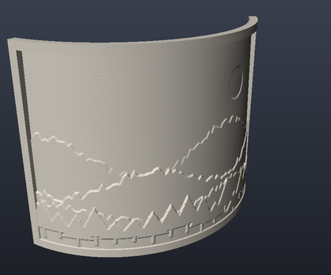 |
| **Inner curve** | A panel bent the other way, with the relief on the inside (concave). | 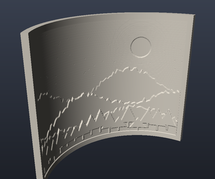 |
| **Cylinder (lamp)** | The image wraps all the way around a tube. The image width becomes the circumference. Designed to go over a light. | 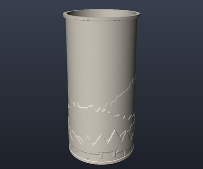 |
| **Heart** | Like the cylinder, but with a heart-shaped cross-section. | 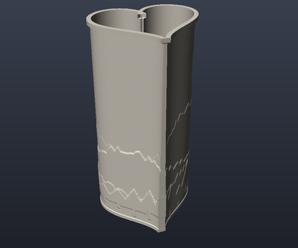 |
| **Dome** | A spherical cap that is open at the top. The image wraps around the rim and climbs towards the top. Works as a lamp shade. | 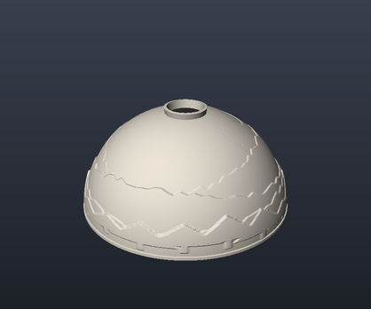 |

## Light support

The light support is a separate base that holds the lithophane upright in a slot and houses the light.
Choose a **Light source** to enable it. The support appears in **blue** in the preview.

When a light support is enabled, the **Export as** option appears above the export buttons (see
[Exporting](#exporting)).

### Common settings

| Setting | Default | Meaning |
|---|---|---|
| **Light source** | None | *None*, *LED strip / string* or *Lamp*. |
| **Base height (mm)** | 20 | Total height of the base. It is raised automatically if the cable groove would not fit, and the info line says so. |
| **Slot depth (mm)** | 4 | How deep the lithophane sits in the base. Keep the **border** at least this tall so no part of the image is hidden. |
| **Slot clearance (mm)** | 0.3 | Gap on each side of the lithophane inside the slot. Increase it if the print fits too tightly, and reduce it if it wobbles. |
| **Wall thickness (mm)** | 2 | Thickness of the base walls. |
| **Min. base depth (mm)** | 30 | Minimum front-to-back depth of the base, for stability. Only used for flat and curved panels. |
| **Cable hole Ø (mm)** | 6 | Hole for the power cable. It connects to a groove under the base so the base still sits flat. |

### LED strip / string

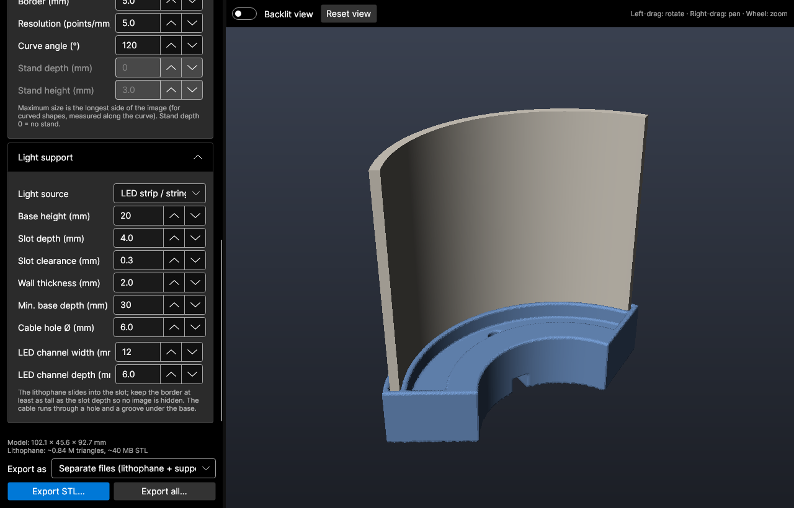

- **Flat and curved panels:** a channel runs behind the lithophane, following its curve.
- **Cylinder, heart and dome:** a tray fills the whole inside.

| Setting | Default | Meaning |
|---|---|---|
| **LED channel width (mm)** | 12 | Width of the channel (not used for closed shapes, where the tray fills the inside). |
| **LED channel depth (mm)** | 6 | Depth of the channel or tray. It is limited automatically so the cable groove still fits underneath. |

### Lamp

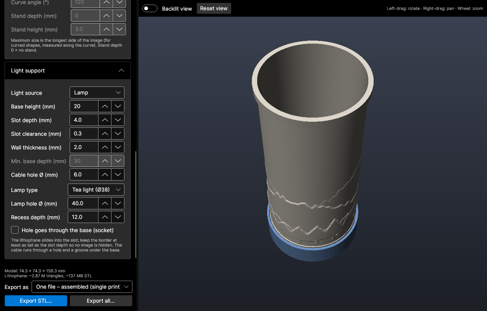

A round recess or through-hole in the middle of the base. Pick a **Lamp type** preset or enter your own
values:

| Preset | Hole Ø | Type |
|---|---|---|
| Tea light (Ø38) | 40 mm | 12 mm recess |
| LED puck light (Ø60) | 62 mm | 12 mm recess |
| E14 socket | 29 mm | through-hole |
| E27 socket | 40.5 mm | through-hole |
| Lamp tube M10 | 10.5 mm | through-hole |
| Custom | — | keeps whatever you type |

| Setting | Meaning |
|---|---|
| **Lamp hole Ø (mm)** | Diameter of the recess or hole. For closed shapes it is reduced automatically if it would not fit inside the lithophane. |
| **Recess depth (mm)** | Depth of the recess (ignored for through-holes). |
| **Hole goes through the base** | Makes a through-hole instead of a recess, for lamp sockets and threaded tubes. |

Any automatic adjustment (raised base, shallower recess, smaller hole) is listed with a ⚠ in the info
line.

### Show the light source in the preview

With this box ticked, the preview also draws the light inside the base: an LED strip with its chips in
the channel or tray, a tea light / puck standing in the recess, or a socket with a bulb for
through-holes. It is only drawn in the preview and is **never exported**. The size of the bulb follows
the hole diameter.

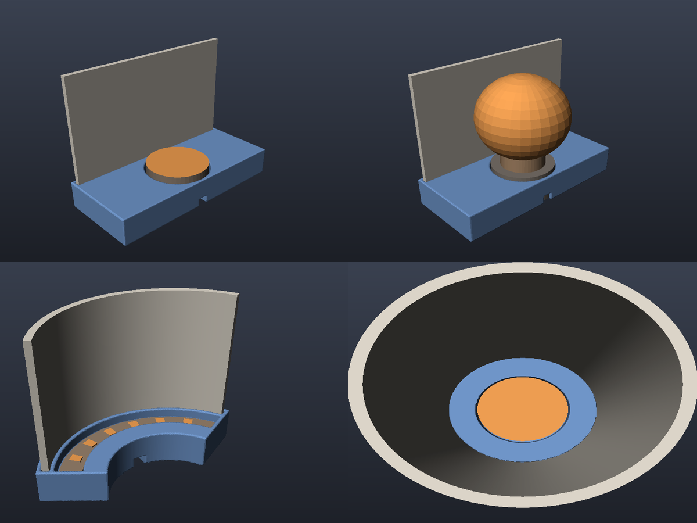

## 3D preview

| Action | Mouse |
|---|---|
| Rotate | Left-drag |
| Pan | Right-drag (or middle-drag) |
| Zoom | Mouse wheel |
| Reset camera | **Reset view** button |

### Backlit view and the light simulator

**Backlit view** replaces the normal shading with a simulation of light shining through the plastic,
so you can judge contrast and colour before printing. A row of controls appears above the preview:

| Control | Meaning |
|---|---|
| **Light** | Colour of the light: warm white (2700 K), soft white (3000 K), neutral (4000 K), cool white (6500 K), a few colours, or **Custom** (click the swatch to pick any colour). Picking a colour in the swatch switches the list to *Custom*. |
| **Power** | Brightness of the light, 10–400 %. 100 % is a typical LED strip or lamp. Use it to see what a brighter or dimmer light would do. |
| **Filament** | Colour of the filament you will print with (white, ivory, light grey, colours, or **Custom**). The print is assumed to be solid (100 % infill). |

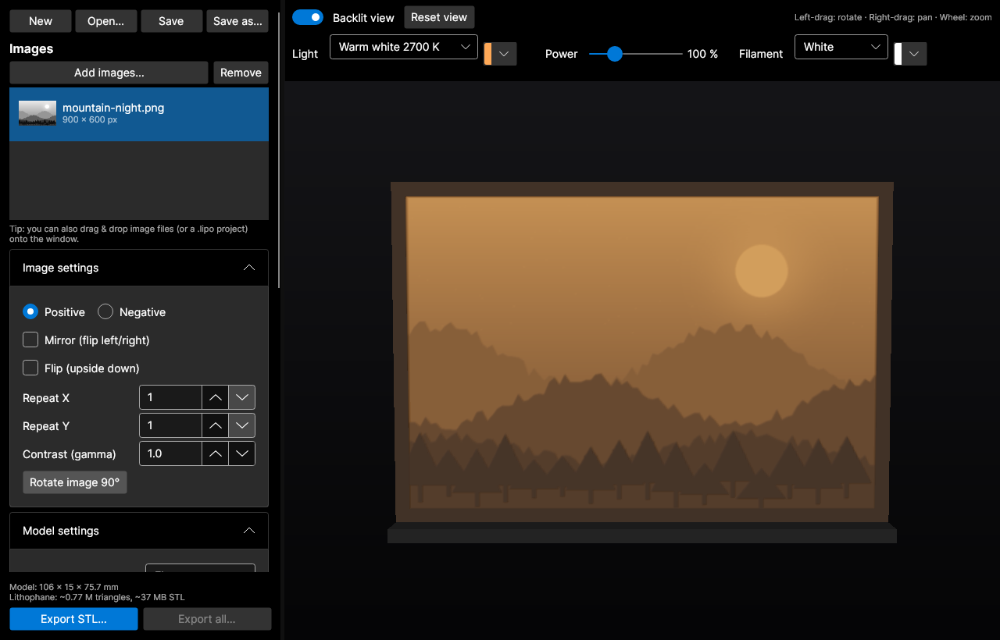

How it is computed:

- The thickness at each point and the filament colour decide how much of each colour of light gets
  through (Beer–Lambert absorption; white PLA at 100 % infill passes about 20 % through 1 mm and
  about 1 % through 3 mm). A coloured filament absorbs the other colours more strongly, so thick areas
  turn into a deep version of the filament colour and thin areas glow bright.
- With a **light support**, the light's real position is used: an LED strip at the bottom lights the
  lower part of a panel more than the top, a bulb lights what is around it, and the wall between the
  slot and the light casts its shadow. Without a support, the light is assumed to be even.
- The result is tone-mapped like a camera, so very bright areas roll off softly instead of clipping.

These settings are stored in the project.

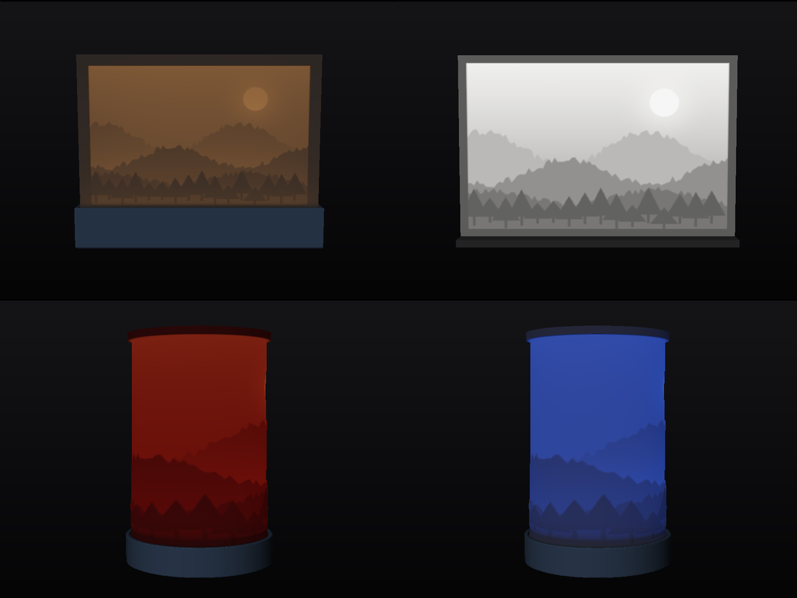

> **Tip:** if the picture only shows up at a high power, the print will be dark in real life. Reduce
> **Thickness** or **Thinnest layer**, or lower the gamma, rather than relying on a stronger light.

## Exporting

- **Export STL…** writes the selected image's model to the file you choose.
- **Export all…** asks for a folder and writes one model per image, named after each image.

Exports use the full resolution (the preview is simplified). Large, high-resolution models can take a few
seconds, and the status bar shows progress.

### Export layouts (only when a light support is enabled)

| Layout | Files written | When to use |
|---|---|---|
| **Separate files** | `name_lithophane.stl` and `name_light_support.stl` | Print each part with its own settings (recommended). |
| **One file – parts side by side** | `name.stl` | Both parts on one plate, ready to slice together. |
| **One file – assembled** | `name.stl` | The lithophane standing in its base, printed as a single piece. |

All STL files are **binary**, **watertight**, and use **Z = up**, with the model standing upright and
centred on the origin.

## Printing tips

These are general recommendations that work well for most FDM printers:

- **Orientation:** print the lithophane **upright**, as exported. This gives the best detail and smooth
  gradients.
- **Material:** white or natural (translucent) PLA. Dark or very opaque filaments block too much light.
- **Infill:** 100%. Otherwise the infill pattern shows through when lit.
- **Layer height:** 0.1–0.12 mm for fine detail.
- **Speed:** print slowly (outer walls around 20–30 mm/s). Tall, thin prints benefit from a brim.
- **Thickness:** 3 mm maximum and 0.8 mm minimum is a good starting point. Increase the maximum for
  more contrast with strong lights.
- **Light supports:** print them in any colour and with normal infill. Test the slot fit with a small print
  first and adjust **Slot clearance** if needed.
- **Heat:** use LED light sources. Incandescent bulbs and real candles can soften PLA.

## Troubleshooting

| Problem | Fix |
|---|---|
| The print is too dark when lit | Reduce **Thickness**, lower **Contrast (gamma)**, or use a brighter light. |
| Details look washed out | Increase **Thickness**, reduce **Thinnest layer**, or raise gamma above 1. |
| The image is mirrored when viewed from the front | Toggle **Mirror**. |
| The STL is very large | Lower **Resolution**. 5 points/mm is enough for a 0.4 mm nozzle. |
| Part of the image is hidden in the base | Make the **Border** at least as tall as the **Slot depth**. |
| The lithophane doesn't fit in the base | Increase **Slot clearance** (e.g. 0.4–0.5 mm). |
| An image fails to load | The format isn't supported on this system. Convert it to PNG or JPG. |

## Keyboard shortcuts

| Shortcut | Action |
|---|---|
| Ctrl+N | New project |
| Ctrl+O | Open project |
| Ctrl+S | Save project |
| Ctrl+Shift+S | Save project as |
